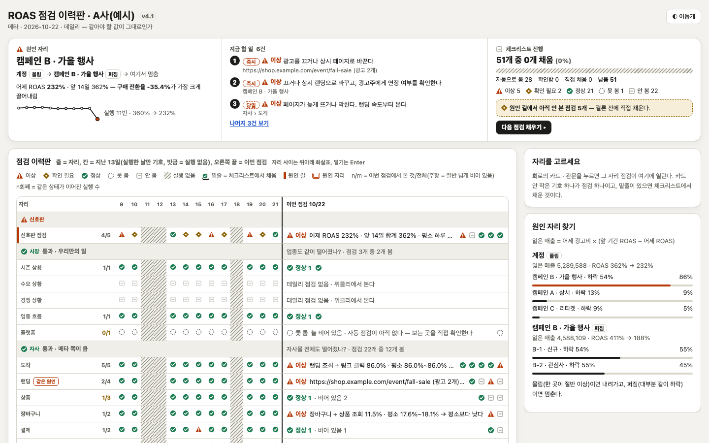

# roas-check — 메타 광고 ROAS 저하 점검 스킬

메타(페이스북 · 인스타그램) 광고의 ROAS가 떨어졌을 때 원인을 순서대로 좁혀 가는 **대화형 점검 스킬**과, 점검 결과를 한 장으로 보여 주는 **대시보드**다.

- 스킬은 대화로 진행한다. "어디를 열어 무엇을 보내 달라"를 카드 한 장씩 안내하고, 받은 숫자로 원인 자리를 좁힌다. 웹 대화(Claude 웹 등)에서 도구 없이 쓰도록 만들었고, 터미널(Claude Code)에서도 쓴다.
- 점검 순서는 바깥에서 안쪽이다. 정말 떨어졌나 → 어느 캠페인 · 광고세트에 몰렸나 → 웹 상태 · 매체 설정 · 측정 · 시장 순으로 본다.
- 점검이 끝나면 스킬이 **결과 블록** 하나를 낸다. 대시보드에 붙이면 그 점검이 이력판 · 할 일 · 진행 순서에 보이고, 브라우저에 쌓여 다음 점검의 지난 칸이 된다.

어베어의 사내 과제(미션)에서 시작했다. **시험에 쓴 광고주 이름과 숫자, 대시보드 예시('A사(예시)'), 결과 블록 예시는 모두 지어낸 것**이다. 실제 계정의 데이터는 들어 있지 않다.

바뀐 것은 [`CHANGELOG.md`](CHANGELOG.md)에 있다.

## 폴더
| 폴더 | 내용 |
|---|---|
| `skill/roas-check/` | 스킬 본체(v4). `SKILL.md`(단계 카드: 데일리 0~6 · 위클리 W1~W3), `references/checklist.md`(점검 87개: 데일리 55 · 위클리 32), `references/screen-guide.md`(광고 관리자 화면 위치), `references/result-block.md`(결과 블록 쓰는 법) |
| `skill/roas-check.zip` | 올리기용 묶음. 위 폴더와 내용이 같다 |
| `skill/README.md` | 설치 · 쓰는 법(Claude 웹 · ChatGPT · Claude Code · Codex) |
| `dashboard/` | `ROAS_점검_대시보드_v4.6_붙여넣기.html`(빈 판, 실제로 쓰는 파일), `…_v4.6_데일리.html` · `…_v4.6_위클리.html`(예시 판), `ROAS_점검_지도.html`(점검 87개 지도). 모두 파일 하나로 열린다 |
| `engine/` | 판정 엔진(파이썬 표준 라이브러리만 씀), 대시보드 화면 틀(`board_template.html`, 옛 화면 틀 `board_template_v*.html`), 렌더러 |
| `html/` | 점검 지도 원본. 점검 항목의 정본은 `html/checks.js`다 |
| `tools/` | `gen_checklist.py`(체크리스트 다시 만들기), `make_example.sh`(대시보드 세 파일 다시 만들기) |
| `docs/` | 결과 블록 형식(`결과블록_형식.md`)과 예시(`결과블록_예시/`), 설계(`ROAS_저하_체크_설계.md`), 스킬 시험 보고서(`스킬시험_v2.md`)와 채점 자료(`스킬시험_v2/`), 대시보드 v4 · v4.1 변경 설명, 디자인 리서치, 첫 판 스크린숏(`screenshots/`) |

## 스킬 설치 · 쓰는 법
**Claude 웹 · 앱**: 왼쪽 사이드바 사용자 지정 › Skills › 추가(＋) › Skill 업로드에서 `skill/roas-check.zip`을 올린다. 올리면 켜진 상태다.
**Claude Code · Codex**: `skill/roas-check/`를 `~/.claude/skills/` · `~/.agents/skills/`에 둔다. 다른 환경은 [`skill/README.md`](skill/README.md)를 본다.

대화에서 이렇게 시작한다.
- "메타 ROAS가 어제 갑자기 떨어졌어" → 데일리 점검(카드 0~6)
- "몇 주째 ROAS가 내려가" → 위클리 점검(카드 W1~W3)
- "예시로 보여 줘" → 지어낸 A사 사례로 시연

숫자를 적어도 되고 광고 관리자 캡처나 내보내기 파일을 올려도 된다. 비밀번호 · 토큰은 받지 않는다. 스킬이 광고를 직접 켜거나 끄지는 않는다. 할 일은 "하겠습니다 · 요청하겠습니다"로만 정리한다.

**터미널(Claude Code)에서 쓸 때**: 캡처 · 내보내기 파일을 작업 폴더 하나에 모으고 그 폴더에서 시작한다. 파일은 경로로 알려 준다(예: `자료/캡처1_계정.png`). 스킬은 알려 준 경로만 읽고 작업 폴더에만 쓴다. 처음 몇 번은 파일 읽기 · 쓰기마다 권한을 묻는다.

## 결과를 대시보드로 옮기기
점검이 끝나면 답 맨 끝에 결과 블록(코드 블록) 하나가 나온다. 피드백 뒤에 블록이 한 번 더 나오면 마지막 블록을 쓴다.
- **웹**: 블록 칸 오른쪽 위 **복사 단추**를 누른다. `dashboard/ROAS_점검_대시보드_v4.6_붙여넣기.html`을 열고 '스킬 결과 붙여넣기'에 붙인 뒤 '읽고 화면 그리기'를 누른다. 울타리 없이 JSON만 복사돼도 읽힌다.
- **터미널**: 복사 단추가 없다. 마무리의 "블록을 파일로 저장해 드릴까요?"에 답하면 작업 폴더에 `roas-결과-<광고주>-<날짜>.json`이 생긴다. 판의 '스킬 결과 붙여넣기' › **파일에서 읽기(.json)**로 그 파일을 고른다(글 상자에 끌어 놓아도 된다). 파일 내용이나 화면에서 `{`부터 `}`까지 끌어 고른 글을 그대로 붙여도 읽힌다.
- 같은 광고주 · 리듬 · 날짜를 다시 넣으면 판이 바꿔 쓸지 따로 남길지 묻는다.
- 결과는 그 브라우저에만 저장되고 인터넷으로 보내지 않는다. 다른 브라우저로 옮길 때는 '이력 내려받기 · 불러오기'를 쓴다. 블록 형식은 [`docs/결과블록_형식.md`](docs/결과블록_형식.md)에 있다.

## 대시보드
**보기**: `dashboard/`의 HTML 파일을 브라우저로 연다. 외부 파일 · 인터넷 연결 없이 그 파일 하나로 열린다.
- 붙여넣기 판: 예시 데이터가 없는 빈 판이다. 블록을 붙이면 그린다.
- 예시 판(데일리 · 위클리): 엔진이 지어낸 데이터로 그린 판이다. 여기에도 블록을 붙일 수 있다.
- 이력판: 줄 = 점검 자리, 칸 = 지난 날(데일리 13일 · 위클리 7주), 오른쪽 끝 = 이번 점검.
- 진행 순서 탭: 스킬의 카드 흐름과 이번 점검이 지난 자취를 보여 준다.



**다시 만들기**(파이썬 3, 추가 설치 없음)
```sh
zsh tools/make_example.sh            # 예시 데이터로 dashboard/ v4.6 세 파일을 다시 만든다(작업 폴더 ./runs_example)
python3 engine/render_board.py --blank --out 빈판.html   # 붙여넣기 빈 판만 따로
python3 tools/gen_checklist.py       # html/checks.js → references/checklist.md · engine/checklist.json
python3 html/build.py                # html/ → dashboard/ROAS_점검_지도.html
```
- 다시 만든 데일리 예시 판은 실행한 날짜에 따라 신호판 근거 한 문구('전환이 늦게 잡히는 중일 수 있다')가 빠질 수 있다. 엔진이 오늘 날짜와 비교하기 때문이다. 나머지는 같다.
- 실제 계정으로 돌리는 순서(광고 관리자 내보내기 · 메타 API · 웹 점검)는 [`engine/README.md`](engine/README.md)에 있다. 메타 API는 읽기만 하고, 토큰은 환경변수로만 받는다.

## 시험 결과
2026-10-23에 시나리오 4개로 시험했다. 측정 끊김, 업종 전체 하락(시장), 서툰 사용자(캡처만 줌 · 기간 틀림 · 오타 · 품절)는 데일리, 소재 피로는 위클리다. 모델은 6개(Claude 오푸스 · 소넷, Codex 계열 3개, 제미나이)를 썼다. 시험 에이전트는 49회 띄웠고 실제로 돈 것은 47회다(제미나이 2회는 할당량이 떨어져 시작하지 못했다). **47회 중 원인을 틀린 경우는 0회**였다. 최종 6모델 24회 중 3회는 근거나 할 일이 덜 채워져 '부분'으로 채점됐다. 자세한 표와 실패 사례는 [`docs/스킬시험_v2.md`](docs/스킬시험_v2.md)에 있다.

그 뒤(10/26~27) 실제 Claude 웹과 Claude Code 터미널에서 시험하며 스킬과 대시보드를 고쳤다. 마지막 판(스킬 v4 · 대시보드 v4.6)으로는 서툰 사용자 시나리오를 웹 1회 · 터미널 1회 돌렸고, 둘 다 원인을 맞혔다. 결과 블록도 판에 그대로 읽혔다. 독립 검토 결론은 '그대로 써도 됨'(심각 0건)이었다.

## 남은 한계
- 시험은 에이전트가 사용자 역을 맡은 대화였다. 실제 마케터와의 시험은 아직 없다. 마지막 판은 오푸스로 시나리오 하나만 확인했다.
- 웹 대화에서는 계산을 손으로 해서 평소 범위 같은 숫자를 잘못 계산한 적이 있다. 판정이 바뀐 경우는 없었다.
- 독립 검토에서 남은 것(다음 고치기에서 손볼 것)
  - 스킬 글이 둘로 읽히는 곳 둘: 카드 0에서 볼 수 있는 화면을 짧게 답하면 사이트 카드를 묻지 않을 수 있다. 카드를 통째로 건너뛴 것과 카드 안에서 하나를 건너뛴 것의 구분이 글에 없다.
  - 대시보드: 위클리 블록에 데일리 문장 '자사몰 전체도 떨어졌나?' 줄이 있으면 신호판에 자사몰 질문이 데일리 · 위클리 두 줄로 겹쳐 보이고, 위클리 줄이 '스킬이 봄'으로 세어질 수 있다.
  - 사소: 진행표 머리 예의 '여기서 멈춤'이 블록 말(몰림 · 퍼짐 · 보류)과 다르다. 정상 줄을 늘어놓을지 수로 접을지가 두 갈래다. 체크리스트의 '결제가 되나?' 이상 신호에 '자사몰 주문이 평소면 측정 쪽'이라는 단서가 없다. 결과 블록 형식 두 곳에 관문 설명 '메타만큼'이 남았다(다른 곳은 '메타 하락률의 절반 이상'). 건너뛴 카드에서도 묻고 닫은 두 줄은 적는다는 예외가 `SKILL.md`에 없다. 터미널 마무리가 물음 둘(피드백 · 파일 저장)로 끝난다.
- 메타 광고 연결(MCP)로 숫자를 직접 읽는 갈래는 제안만 했고 넣지 않았다(`docs/스킬시험_v2/메타연결_제안.md`).
- 대시보드 진행 순서 탭의 문구는 `SKILL.md`를 손으로 줄여 넣은 것이라, 스킬을 고치면 화면 틀도 손으로 맞춰야 한다.
- Claude 웹에서는 생각 중 상태 줄이 영어로 보일 수 있다(제품 표시). 광고 관리자 메뉴 이름은 메타 화면 버전에 따라 조금 다를 수 있다.

라이선스: MIT
